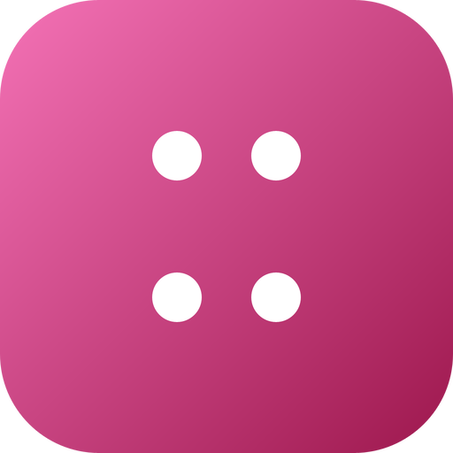

# go-embedded-fortran — brand assets

Official logos for the **go-embedded-fortran** organization.

The mark is Fortran's double colon, `::`, the separator of a declaration (`integer, parameter :: n = 8`): two colons side by side. It is a glyph of the language's syntax, and it does not copy any Fortran logo. It is written by `mark/main.go`, which centres the glyph on the badge from a few constants; nothing is placed by hand. Its gradient (`#F472B6` to `#9D174D`) sets go-embedded-fortran apart from the other go-* organizations.

## Formats

- **SVG** — `svg/color`, `svg/white` (white, transparent), `svg/black` (black, transparent)
- **PNG** 16→1024 px, 3 variants — `png/<variant>/<size>/`
- **JPG** (color, white background) — `jpg/<size>/`
- **ICO** (Windows) — `ico/`
- **ICNS** (macOS) — `icns/`
- **GitHub avatar** 512 px — `avatar/`
- **Social preview** 1280×640 (repo banner) — `social/`

`check/kit.py` counts the whole matrix on every pull request, and the `mark` job runs `mark/main.go` again and fails if `svg/color/go-embedded-fortran.svg` differs.

---
*Generated from `svg/color/go-embedded-fortran.svg` by the fleet's Go brand pipeline (brandgen) — rounded square badge, glyph, color / white / black variants.*
